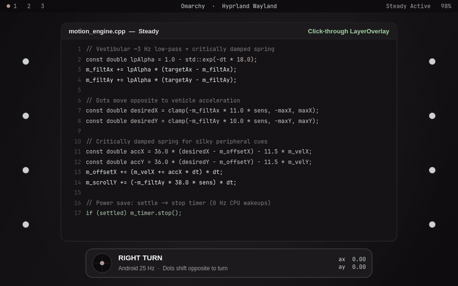
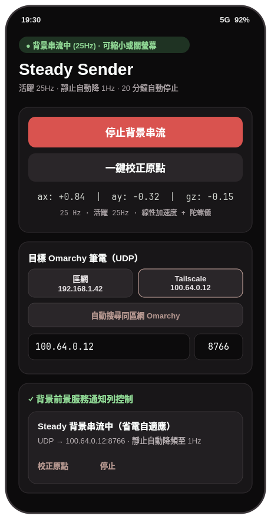

# Steady

**Motion-sickness relief peripheral cues for Wayland / Hyprland (Omarchy) + low-power Android background IMU sender.**

[](LICENSE)

Steady renders subtle, click-through peripheral motion cues along the left and right edges of your Linux Wayland display (similar to Apple Vehicle Motion Cues / Android Motion Assist), driven either by built-in driving simulations or real-time accelerometer & gyroscope data streamed from your Android phone over LAN Wi-Fi or Tailscale.

> **繁體中文簡介**：Steady 是專為 Wayland / Hyprland（Omarchy）打造的防暈車／防暈眩視覺輔助工具。透過左右螢幕邊緣的滑鼠穿透式動態圓點，搭配超輕量（~33 KB）的 Android 原生背景傳感器 APK（可縮小、切 App、關螢幕省電運行），將車輛的加減速與轉彎慣性同步呈現於餘光中，減少視覺與內耳前庭的訊號衝突。

---

## Demo & Screenshots

<p align="center">
  
</p>

<p align="center">
  <em>12-second driving cycle demo (Right Turn → Braking → Left Turn → Acceleration → Stopped Auto-Hide &amp; 1 Hz Power Save) · <a href="docs/media/demo.mp4">Download 30fps MP4 video (196 KB)</a></em>
</p>

| Desktop Wayland Overlay | Control Panel (Qt6) | Android Background Sender (~33 KB APK) |
| :---: | :---: | :---: |
|  |  |  |

---

## Features

### Desktop (Linux Wayland / Hyprland / Qt6)
- **Click-through dual-strip Wayland overlay**: Uses two slim `116 px` `LayerShellQt` `LayerOverlay` strips anchored to the left and right screen edges (`ExclusiveZone -1`, `WindowTransparentForInput`, zero keyboard focus) — leaves the center of the display untouched and cuts Wayland SHM pixel uploads by ~82%.
- **Battery-friendly idle-sleep engine**:
  - `40 Hz` `Qt::CoarseTimer` during active motion (allows Linux timer coalescing & deep CPU C-states).
  - Automatically stops the animation timer (`0 Hz` CPU wakeups, zero Wayland commits) once dots settle or fade out.
  - Throttled `4 Hz` QML telemetry updates; `Qt::VeryCoarseTimer` disconnect & TLS idle-client sweepers that stop themselves when idle.
- **Built-in driving simulator**: City, Highway, Mountain, and Manual impulse presets for instant visual testing.
- **Live Omarchy theme integration**: Watches `~/.local/state/omarchy/current/theme/colors.toml`.
- **Zero-dependency local pairing**: Built-in HTTPS/WSS (`:8765`), UDP receiver & LAN auto-discovery (`:8766`), QR code generator, and direct APK download endpoint (`/steady-sender.apk`).

### Android Sender (`Steady Sender` APK, ~33 KB)
- **True background & screen-off operation**: Native Android `ForegroundService` (`specialUse`, Android 8–17 / One UI compatible) with bounded `PARTIAL_WAKE_LOCK` and persistent notification controls (**Calibrate** & **Stop**).
- **Adaptive radio & battery saving**:
  - Active driving: `25 Hz` linear acceleration + gyroscope with `40 ms` sensor-hub hardware FIFO batching.
  - Stationary ≥ 4 s (e.g., red light / parked): drops UDP transmit rate to `1 Hz` keepalive (**-96% Wi-Fi / 5G + Tailscale radio wakeups**).
  - Stationary ≥ 20 min (or offline ≥ 5 min): auto-stops service and releases WakeLock.
  - Allocation-free ASCII JSON hot loop + zero UI polling when idle.
- **Zero-typing pairing**: One-tap LAN UDP auto-discovery (`{"cmd":"discover"}`), `steady://connect` deep-link support, portrait/landscape orientation switch, and quick LAN / Tailscale IP chips.

---

## Architecture

```text
+------------------------------+         UDP :8766 (25Hz active / 1Hz idle)        +-----------------------------------+
|  Android Phone               |  ---------------------------------------------->  |  Omarchy / Linux Wayland Desktop  |
|  Steady Sender (~33 KB APK)  |         HTTPS :8765 (QR / APK / Web fallback)     |  Steady (Qt6 + LayerShellQt)      |
|  - ForegroundService         |  <--------------------------------------------->  |  - SensorServer (UDP + TLS/WSS)   |
|  - Sensor FIFO batching      |                                                   |  - MotionEngine (3Hz LPF + spring)|
|  - Adaptive 25Hz -> 1Hz      |                                                   |  - 2x 116px LayerOverlay strips   |
+------------------------------+                                                   +-----------------------------------+
```

---

## Quick Start

### 1. Build & Run Desktop (Arch Linux / Omarchy)

Dependencies:
```bash
sudo pacman -S --needed qt6-base qt6-declarative qt6-wayland layer-shell-qt openssl qrencode
```

Build & launch:
```bash
./bin/build
./build/steady
```

Run automated ASan + UBSan test suite:
```bash
./bin/test
```

Install as an Arch Linux package (adds app launcher entry & icon):
```bash
./bin/install
```

### 2. Build Android Background APK

Requires JDK 21+ and Android SDK (`platforms/android-35` + `build-tools/35.0.0` or newer, no Gradle needed):

```bash
# Optional: use your own release keystore & password
export STEADY_KEYSTORE="$HOME/.local/share/steady/android-signing.jks"
export STEADY_KS_PASS="your-strong-password"

./android/build-apk.sh
# Output: ./build/steady-sender.apk
```

### 3. Pair Your Phone
1. Launch `steady` and switch to **手機 IMU 串流** (Phone IMU).
2. Scan the QR code from your phone (accept the local self-signed certificate once) and tap **Download Android APK**, or sideload `build/steady-sender.apk` via LocalSend / `adb install`.
3. Open **Steady Sender** on your phone, tap **自動搜尋同區網 Omarchy** (or enter your Tailscale IP), and tap **開始背景串流**. You can now minimize the app or turn off the screen.

> **Firewall note**: If using LAN Wi-Fi with `ufw` enabled, allow the local ports:
> ```bash
> sudo ufw allow 8765/tcp
> sudo ufw allow 8766/udp
> ```

---

## Wire Protocol (UDP `:8766`)

Steady accepts third-party IMU apps (such as HyperIMU and Sensor Logger) as well as its own Android APK:

- **Direct JSON**: `{"ax":0.12,"ay":-0.45,"az":0.01,"gz":-0.08,"grav":false,"src":"Steady Android"}`
- **Calibrate**: `{"cmd":"calibrate"}`
- **LAN Discovery**: send `{"cmd":"discover"}` (or `STEADY_DISCOVER`) to broadcast `:8766` → replies `{"steady":true,"lan":"...","ts":"...","udp":8766}`
- **CSV (HyperIMU)**: `ax,ay,az` or `timestamp,ax,ay,az,gx,gy,gz`
- **Sensor Logger JSON**: `{"payload":[{"name":"linearAcceleration","values":{"x":...,"y":...,"z":...}}]}`

---

## License

Steady is free software licensed under the **GNU Affero General Public License v3.0 or later** (`AGPL-3.0-or-later`).
See [LICENSE](LICENSE) for the full text.
