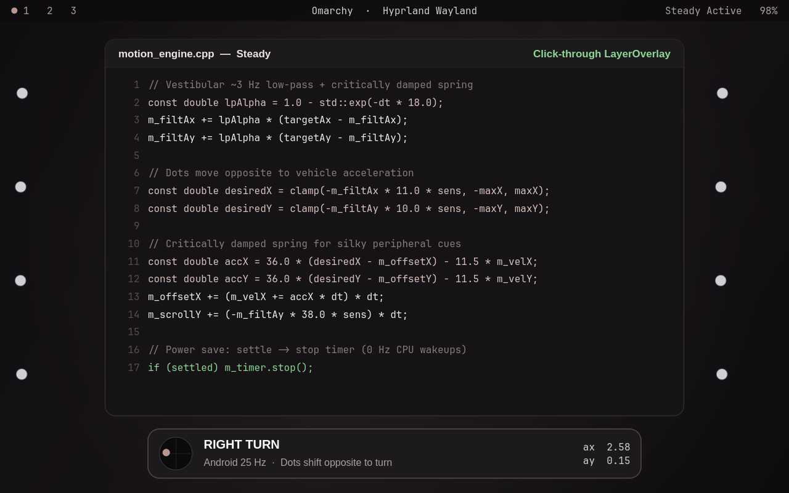
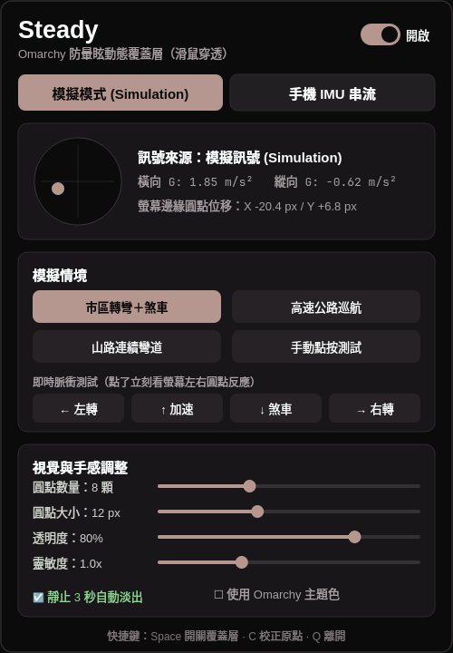

# Steady

**Motion-sickness relief peripheral cues for Linux, macOS and Windows, with a low-power Android background IMU sender.**

[](LICENSE) [](https://gitlab.com/aa22396584/steady/-/releases)

**Releases and downloads:** <https://gitlab.com/aa22396584/steady/-/releases> · **Canonical repository and issues:** <https://gitlab.com/aa22396584/steady> (the GitHub repository is a read-only mirror).

Steady renders subtle, click-through peripheral motion cues along the left and right edges of your primary display (similar to Apple Vehicle Motion Cues / Android Motion Assist), driven either by built-in driving simulations or real-time accelerometer & gyroscope data streamed from your Android phone over LAN Wi-Fi or Tailscale.

> **繁體中文簡介**：Steady 是支援 Linux、macOS 與 Windows 的防暈車／防暈眩視覺輔助工具。透過左右螢幕邊緣的滑鼠穿透式動態圓點，搭配超輕量（約 50 KB）的 Android 原生背景傳感器 APK（可縮小、切 App、關螢幕省電運行），將車輛的加減速與轉彎慣性同步呈現於餘光中，減少視覺與內耳前庭的訊號衝突。

---

## Demo & Screenshots

<p align="center">
  
</p>

<p align="center">
  <em>12-second driving cycle demo (Right Turn → Braking → Left Turn → Acceleration → Stopped Auto-Hide &amp; 1 Hz Power Save) · <a href="docs/media/demo.mp4">Download 30fps MP4 video (196 KB)</a></em>
</p>

| Desktop Wayland Overlay | Control Panel (Qt6) | Android Background Sender |
| :---: | :---: | :---: |
|  |  |  |

---

## Features

### Desktop (Qt 6.10 or later)
- **Click-through dual-strip overlay**: Two `116 px` strips follow the primary screen. Linux Wayland uses `LayerShellQt` overlay surfaces with no exclusive zone or keyboard focus. Linux X11, macOS and Windows use transparent, always-on-top windows. X11 transparency requires a compositor.
- **Battery-friendly idle-sleep engine**:
  - `40 Hz` `Qt::CoarseTimer` during active motion (allows Linux timer coalescing & deep CPU C-states).
  - Automatically stops the animation timer (`0 Hz` CPU wakeups, zero Wayland commits) once dots settle or fade out.
  - Throttled `4 Hz` QML telemetry updates; `Qt::VeryCoarseTimer` disconnect & TLS idle-client sweepers that stop themselves when idle.
- **Built-in driving simulator**: City, Highway, Mountain and Manual impulse presets for visual testing. Continuous presets pause after 10 minutes of inactivity. The panel explains the pause and offers **繼續模擬** (Resume).
- **Appearance**: Uses the Qt system accent when available and follows the Omarchy theme when its colors file is present. Motion and appearance settings are saved between sessions.
- **Local pairing**: UDP receiver and LAN discovery (`:8766`), optional HTTPS/WSS (`:8765`), built-in QR encoding, and an APK download endpoint (`/steady-sender.apk`).

### Android Sender (`Steady Sender` APK, ~50 KB)
- **True background & screen-off operation**: Native Android `ForegroundService` (`specialUse`, Android 8–17 / One UI compatible) with bounded `PARTIAL_WAKE_LOCK` and persistent notification controls (**Calibrate** & **Stop**).
- **Adaptive radio & battery saving**:
  - While driving, the phone samples acceleration and gyroscope at `25 Hz`, averages each pair, and sends at `12.5 Hz` with an `80 ms` sensor batch.
  - After about 4 seconds without motion (linear acceleration under `0.22 m/s²` and yaw rate under `0.08 rad/s`), it unregisters the gyroscope, samples acceleration every 100 ms without batching, and sends one keepalive per second. Each keepalive adds `"idle":true` and carries the original readings. The first sample over a threshold ends stationary mode and is sent at once.
  - About every 10 seconds it sends discovery on the same UDP socket. After three missed replies it pauses samples, probes at most once a second, and shows **desktop not reachable**. A reply resumes samples. After five minutes unreachable or twenty minutes stationary, it stops the service and releases the wake lock.
  - Allocation-free ASCII JSON hot loop + zero UI polling when idle.
- **Zero-typing pairing**: LAN discovery uses the reply packet's source address. A `steady://connect?host=&port=` link asks for confirmation before changing the saved target.

---

## Architecture

```text
+------------------------------+       UDP :8766 (12.5 Hz active / 1 Hz idle)     +-----------------------------------+
|  Android Phone               |  ---------------------------------------------->  |  Linux / macOS / Windows          |
|  Steady Sender (~50 KB APK)  |         HTTPS :8765 (QR / APK / Web fallback)     |  Steady GUI / steady-cli (Qt 6)  |
|  - ForegroundService         |  <--------------------------------------------->  |  - SensorServer (UDP + TLS/WSS)   |
|  - Sensor FIFO batching      |                                                   |  - MotionEngine (3Hz LPF + spring)|
|  - Adaptive 12.5 Hz -> 1 Hz  |                                                   |  - GUI: 2x 116px overlay strips   |
+------------------------------+                                                   +-----------------------------------+
```

---

## Quick Start

### 1. Build & Run Desktop

#### Arch Linux

Build with GCC, make and Qt 6:

Dependencies:
```bash
sudo pacman -S --needed gcc make qt6-base qt6-declarative qt6-wayland layer-shell-qt openssl
```

Build & launch:
```bash
./bin/build
./build/steady
```

Run automated ASan + UBSan test suite:
```bash
./bin/test
```

Install as an Arch Linux package (adds app launcher entry & icon):
```bash
./bin/install
```

For a Linux X11-only build without LayerShellQt, run `./bin/build CONFIG+=no_layershell`. Use the default build for Wayland edge placement.

#### macOS

Install Xcode or Apple Command Line Tools and put Qt 6's `qmake6` or `qmake` on `PATH`. Homebrew provides the required modules.

```bash
brew install qtbase qtdeclarative
./bin/build
./build/steady
./bin/test
```

The test script uses ASan and UBSan. When both Xcode and Command Line Tools are installed, it can use a newer Apple Clang from Command Line Tools for the sanitizer build.

#### Windows

Install Qt 6 for MSVC 2022 including Qt Declarative, then open an **x64 Native Tools Command Prompt for VS 2022**. Set `QTDIR` to your Qt kit directory, or put the kit's `bin` directory on `PATH`.

```bat
set "QTDIR=C:\Qt\6.10.3\msvc2022_64"
bin\build.bat
bin\test.bat
set "PATH=%QTDIR%\bin;%PATH%"
build\steady.exe
```

Run qmake from the normal console code page. With `chcp 65001`, qmake can write a `build\.qmake.stash` that lacks `QMAKE_MSC_VER`. The build and test scripts temporarily switch the code page and discard incomplete stashes.

#### Desktop controls

Steady opens in **手機 IMU 串流** (Phone IMU) on first launch and waits for packets with the animation timer off. Subsequent launches load the saved mode and preset. Closing the control panel unloads its scene while the overlay and receiver keep running. Run `steady` again to reopen it, or start with `steady --no-panel`. Use **離開 (Quit)** or `steady --quit` to exit the running instance.

By default the receiver locks to the IP address of the first phone that sends a sample. The panel shows this address. After the connection watchdog expires or you click **釋放來源 (Release)**, the next sample can claim the lock. Clear **鎖定單一手機來源** in the panel or pass `--no-source-lock` at startup to allow multiple source addresses.

The source lock prevents accidental cross-talk and casual interference; it is not authentication. UDP source addresses can be spoofed. A manual release ignores the released address for about 10 seconds (or until another address claims the lock), but it cannot stop a forged address.

#### HTTPS and pairing

Steady uses the `openssl` executable to generate a self-signed certificate and the Qt TLS backend to serve HTTPS. It searches `PATH` and then the Git for Windows and OpenSSL-Win64 install directories on Windows. Set `STEADY_OPENSSL` to choose a different executable. An empty value disables HTTPS. UDP ingest and discovery remain available when HTTPS is disabled or TLS fails. The desktop and CLI both accept `--no-https`, `--https-port` and `--udp-port`.

Place a locally built `steady-sender.apk` beside the GUI executable or in `share/steady` next to the executable's `bin` directory. Steady also searches the per-user application data directory and, on Linux, `/usr/share/steady/`.

#### Headless CLI

`steady-cli` runs on Linux, macOS and Windows using Qt Core and Qt Network. Use `steady-cli --help` for the full options. `run` defaults to phone mode. `pair` prints the current machine's addresses for a server on port 8765, or a port supplied with `--https-port`. `discover` broadcasts on port 8766 by default and accepts `--port` and `--timeout`. QR codes appear on a terminal unless you use `--no-qr`. With `--json`, stdout contains only ASCII JSON telemetry and status messages go to stderr.

Run the city simulator for three seconds and stream JSON:

```bash
./build/steady-cli run --mode sim --no-https --json --duration 3
```

Start a headless receiver in one terminal and feed it simulated mountain driving from another:

```bash
./build/steady-cli run --no-https --udp-port 28766
./build/steady-cli send --host 127.0.0.1 --port 28766 --preset mountain --duration 3
```

The commands return 0 on success, 2 for invalid arguments, and 3 for socket or connection errors.

`discover` exits 0 after its timeout even when it finds no receivers; empty stdout means that no reply arrived. The desktop limits discovery replies during a flood while continuing to answer again in the next rate window.

`steady-cli run` reports the locked IP as `lockedSource`. Use `steady-cli release --port 28766` in another terminal to release that receiver's source, or start the receiver with `--no-source-lock`. For testing, `steady-cli send --bind <local-ipv4>` selects a local interface address.

#### Release archives

Run `./bin/package` on Linux x86_64 or macOS arm64, or `bin\package.bat` from an x64 MSVC prompt on Windows. The scripts write the release archive and `SHA256SUMS.txt` to `dist/`. The Linux binaries use your system Qt. On macOS, keep `steady-cli` next to `Steady.app` so the CLI can find the bundled Qt frameworks. On Windows, extract the ZIP before running either executable.

The published macOS arm64 archive is built with Homebrew Qt 6.12.0. That bottle and several libraries it deploys have a minimum OS version of macOS 27.0, so this archive requires macOS 27 or newer even though Steady's source can be built with another compatible Qt kit for older macOS releases. The app is ad-hoc signed and has no Developer ID signature or notarization. For the first launch, use **System Settings → Privacy & Security → Open Anyway**, or run `xattr -dr com.apple.quarantine Steady.app steady-cli`. If SmartScreen prompts on Windows, choose **More info → Run anyway**.

The macOS and Windows archives contain a `THIRD-PARTY-LICENSES` directory with an exact deployed-file inventory, licence texts and Qt source locations. The Windows archive also carries the MSVC runtime and the OpenSSL executable, libraries and Qt TLS plugin needed for HTTPS certificate generation after extraction.

### 2. Build Android Background APK

Requires JDK 21+ and Android SDK (`platforms/android-35` + `build-tools/35.0.0` or newer, no Gradle needed):

```bash
# Optional: use your own release keystore & password
export STEADY_KEYSTORE="$HOME/.local/share/steady/android-signing.jks"
export STEADY_KS_PASS="your-strong-password"

./android/build-apk.sh
# Output: ./build/steady-sender.apk
```

### 3. Pair Your Phone
1. Launch `steady`. Select **手機 IMU 串流** (Phone IMU) if a simulation is active.
2. Scan the QR code from your phone (accept the local self-signed certificate once) and tap **Download Android APK**, or sideload `build/steady-sender.apk` via LocalSend / `adb install`.
3. Open **Steady Sender** on your phone, tap **自動搜尋同區網電腦** (or enter your Tailscale IP), and tap **開始背景串流**. You can now minimize the app or turn off the screen.

> **Firewall note**: by default the phone reaches the desktop on UDP `8766` (motion data and discovery). The optional QR pairing page uses TCP `8765`. If the phone shows **desktop not reachable** while Steady is running, its probes are getting no reply, and the desktop's firewall is the usual cause. The phone pauses motion data after about 30 seconds without a reply, keeps probing, and stops its background service after five minutes.
>
> Linux with `ufw` enabled:
> ```bash
> sudo ufw allow 8765/tcp
> sudo ufw allow 8766/udp
> ```
>
> Windows: the first launch may show a Windows Security prompt; choose **Allow** for the network type you are on (home Wi-Fi is often set to *Public*). If you chose **Cancel**, Windows keeps block rules for the program, and those win over any allow rule added later: open **Windows Security → Firewall & network protection → Allow an app through firewall**, find Steady and tick the network type, or delete the blocked entries for it in **Advanced settings → Inbound Rules**. If no prompt ever appeared, add the rules from an administrator Command Prompt, using the full path of the executable you run (`steady.exe` or `steady-cli.exe`):
> ```bat
> netsh advfirewall firewall add rule name="Steady UDP" dir=in action=allow program="C:\path\to\steady.exe" protocol=UDP localport=8766 remoteip=LocalSubnet
> netsh advfirewall firewall add rule name="Steady pairing" dir=in action=allow program="C:\path\to\steady.exe" protocol=TCP localport=8765 remoteip=LocalSubnet
> ```
> `remoteip=LocalSubnet` limits the rule to the desktop's own subnet. When the phone connects over Tailscale or another VPN, put the phone's VPN address (or that subnet) there instead; leaving `remoteip` out allows any sender.
>
> macOS: if the system firewall is on, macOS asks on the first incoming connection whether to allow Steady; allow it, or add the app under **System Settings → Network → Firewall → Options**.

---

## Wire Protocol (UDP `:8766`)

Steady accepts third-party IMU apps (such as HyperIMU and Sensor Logger) as well as its own Android APK:

- **Direct JSON**: `{"ax":0.12,"ay":-0.45,"az":0.01,"gz":-0.08,"grav":false,"src":"Steady Android"}`
- **Stationary keepalive**: adds `"idle":true` to the same JSON keys and real readings. The receiver keeps the connection alive and settles the motion cue without updating the gravity estimate.
- **Calibrate**: `{"cmd":"calibrate"}`
- **LAN Discovery**: send `{"cmd":"discover"}` (or `STEADY_DISCOVER`) to broadcast `:8766` → replies `{"steady":true,"lan":"...","ts":"...","udp":8766}`. The phone sends the same request about every 10 seconds while streaming. Discovery remains available from every address while motion and calibration are locked to one address.
- **CSV (HyperIMU)**: `ax,ay,az` or `timestamp,ax,ay,az,gx,gy,gz`
- **Sensor Logger JSON**: `{"payload":[{"name":"linearAcceleration","values":{"x":...,"y":...,"z":...}}]}`

Sources that send acceleration including gravity (`grav:true`) use a deliberately slow gravity estimate so sustained braking and cornering remain visible. After the phone is rotated or remounted, cues can be wrong for roughly a minute unless you calibrate again. This affects HyperIMU CSV, Sensor Logger accelerometer data, direct JSON that omits `grav` (the default is `true`), and the browser sender when linear acceleration is unavailable. Sources that send linear acceleration with `grav:false`, including Steady Sender on supported phones, are not affected.

---

## Known limitations

- **Windows overlay**: built, tested and checked for the native click-through, layered, topmost and no-activate window styles, but it has had less on-screen testing than Linux and macOS. Reports are welcome.
- **Desktop firewall**: Steady does not add firewall rules itself. A desktop firewall that drops inbound UDP `8766` (the default port) makes the phone report *desktop not reachable* and pause sending; see the firewall note under *Pair Your Phone*.
- **macOS archive**: the published arm64 archive needs macOS 27 or newer (see *Release archives*). Build from source with another Qt kit for older releases.
- **Unsigned archives**: the macOS and Windows archives are not signed or notarized; see *Release archives* for the first-launch steps.
- **Phones with a biased motion sensor**: the Android sender treats the phone as stationary when linear acceleration stays under `0.22 m/s²` and yaw rate under `0.08 rad/s` for four seconds. A phone whose sensor reads above that at rest never enters the stationary power-saving mode; streaming still works.
- **Phones without a linear-acceleration sensor**: the sender falls back to raw accelerometer data and judges motion against a moving average, as in v1.1.0. On such phones a constant acceleration held longer than about five seconds is treated as stationary. Phones with a linear-acceleration sensor (nearly all current ones) are not affected.
- **Source lock**: locking to one phone prevents accidents and casual interference on a shared network. It is not authentication and does not stop a forged source address.

---

## Third-party

The in-process QR encoder is [Project Nayuki’s QR Code generator library](https://www.nayuki.io/page/qr-code-generator-library), C version 1.8.0, distributed under the [MIT license](third_party/qrcodegen/LICENSE).

Release archives that bundle Qt or other runtime libraries include their full notices in `THIRD-PARTY-LICENSES`. Qt is used under LGPL-3.0-only; corresponding Qt 6.12.0 and 6.10.3 source archives are available from [Qt's official release archive](https://download.qt.io/official_releases/qt/) and [Qt's source browser](https://code.qt.io/cgit/).

## License

Steady is free software licensed under the **GNU Affero General Public License v3.0 or later** (`AGPL-3.0-or-later`).
See [LICENSE](LICENSE) for the full text.
